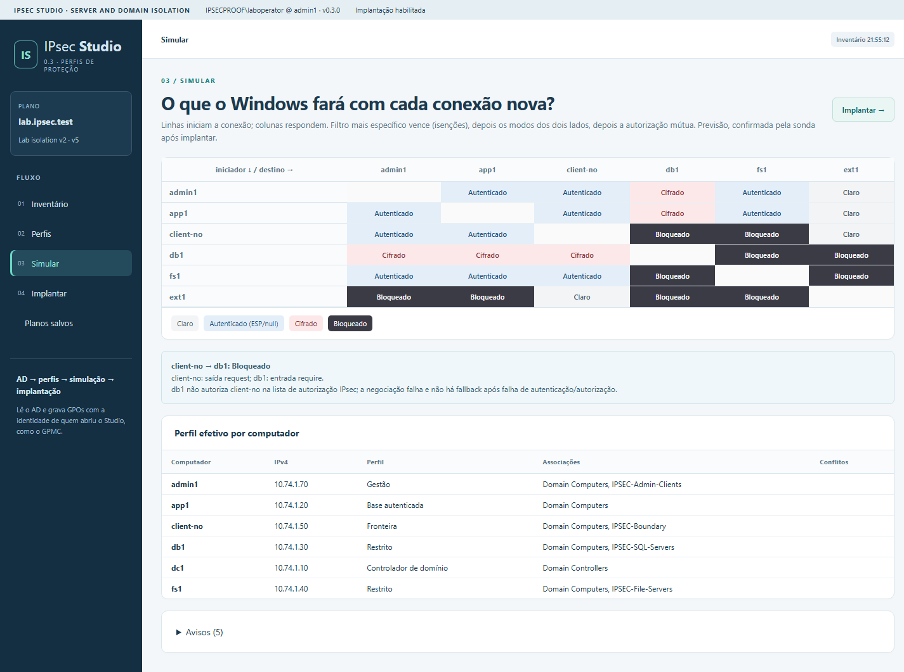
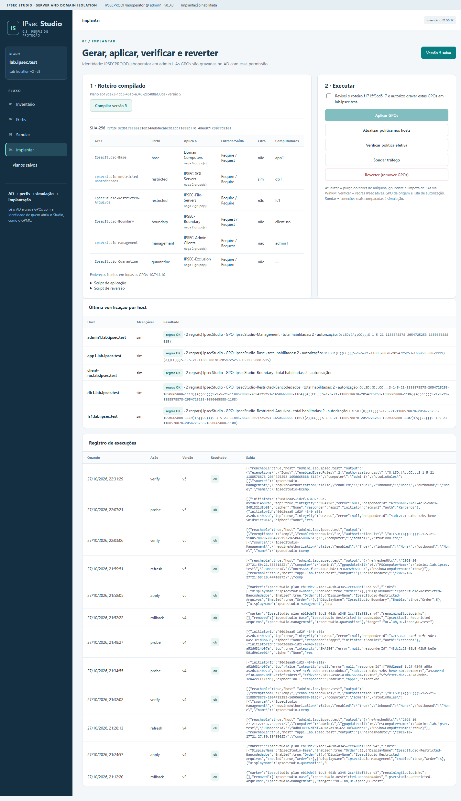

# IPsec Studio

**Server and Domain Isolation with native Windows IPsec — plan, simulate, deploy and verify.**

[Versão em português](README.md)

IPsec Studio turns the classic *Server and Domain Isolation* model (IPsec + Group Policy + Active Directory groups) into a guided workflow: describe **five protection profiles** over AD machine groups, see **what Windows will do with every connection** before touching the domain, generate the GPOs, apply them with your own administrator identity, verify the effective policy on the hosts and **compare real traffic with the simulation**. Everything happens at the network layer; no application changes and no firewall rules.



## The five profiles

| # | Profile | IPsec behavior |
|---|---|---|
| 1 | **Restricted servers** | Only the access group establishes an SA; no clear fallback; optional ESP encryption |
| 2 | **Authenticated base** | Isolated domain: inbound requires IPsec (machine Kerberos, ESP/null), outbound requests |
| 3 | **No IPsec** | Computers without policy and exempt addresses (printers, WSUS, firewalls) treated in clear by everyone |
| 4 | **Boundary** | Accepts clear inbound from peers without IPsec and negotiates with those that can |
| 5 | **Quarantine** | Requires IPsec both ways and authorizes only the management group; everyone else refuses connections from it — just add the machine to the group |

Each computer receives exactly **one profile GPO**: security-group filtering with *Deny Apply* for every other profile. Machine authorization lives in the **IPsec transport authorization list** (Allow for the access group, Deny for the exclusion group), decided by the responder.

## Workflow

1. **Inventory** — reads computers, groups, OUs and GPOs from the domain (read only).
2. **Profiles** — assigns AD groups to profiles and sets parameters (secure subnets, exemptions, cryptography).
3. **Simulate** — initiator × responder matrix with the predicted outcome: *clear*, *authenticated*, *encrypted* or *blocked*, with an explanation per cell.
4. **Deploy** — compiles the PowerShell script (SHA-256 hash), applies the GPOs with the identity of whoever opened the Studio, refreshes and verifies the hosts over WinRM, probes traffic and rolls back.



## Requirements

- Windows Server 2016+ or Windows 10/11 joined to the domain, with RSAT (`ActiveDirectory`, `GroupPolicy`, `NetSecurity` modules).
- An account allowed to create and link GPOs in the chosen scope, with WinRM access to the hosts (refresh, verify, probe).
- Target hosts: Windows Vista/2008 or later (connection security rules). Tested on Windows Server 2022.

## Quick start

```powershell
# publish (self-contained win-x64)
dotnet publish app/IpsecStudio/IpsecStudio.csproj -c Release -r win-x64 --self-contained true -o artifacts/app
# set domain and port in artifacts/app/appsettings.json, then:
artifacts\app\IpsecStudio.exe
# open http://127.0.0.1:5090/
```

The service listens on `127.0.0.1` only and uses the Windows identity of whoever runs it — like GPMC. Do not publish the port or run it as a shared service.

## Documentation

- [Concepts and profile model](docs/en/concepts.md)
- [Installation and configuration](docs/en/install.md)
- [User guide](docs/en/usage.md)
- [Security model and limits](docs/en/security.md)
- [TDD guide](docs/en/tdd.md)

Interface language: Portuguese (default) or English, selectable in the header; the choice is remembered.

## Development

```powershell
scripts\run-checks.ps1          # xUnit tests + gated coverage, UI smoke, build
scripts\install-hooks.ps1       # pre-push hook that runs run-checks
scripts\run-checks.ps1 -Publish # same, plus publish
```

The project follows TDD ([guide](docs/en/tdd.md)): write the test in `tests/IpsecStudio.Tests` (or in the UI smoke) before the code. CI runs only on pull requests and tags, on a Linux runner. Changes to the simulator or the compiler require a lab cycle with an *expected × observed* probe. See [CONTRIBUTING.md](CONTRIBUTING.md) and [CHANGELOG.md](CHANGELOG.md).

## Origin

The implemented model is the *Server and Domain Isolation* design by Rodrigo Immaginario for Universidade Vila Velha (2005–2006, Microsoft case study), updated to current Windows connection security rules and cmdlets.

## License

[MIT](LICENSE) © Rodrigo Immaginario
