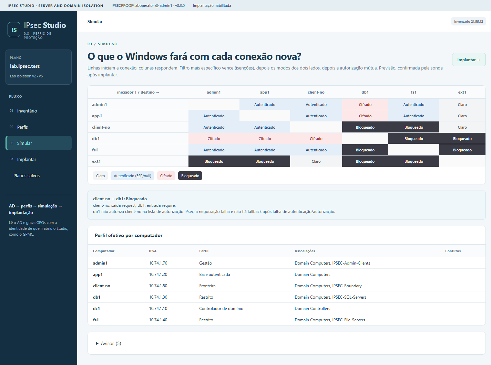
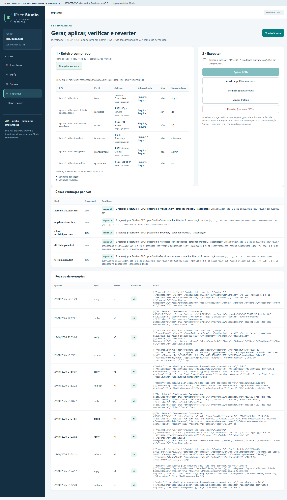

# IPsec Studio

**Server and Domain Isolation com IPsec nativo do Windows — planejar, simular, implantar e verificar.**

[English version](README.en.md)

IPsec Studio transforma o modelo clássico de *Server and Domain Isolation* (IPsec + Group Policy + grupos do Active Directory) em um fluxo guiado: você descreve **cinco perfis de proteção** sobre grupos de máquinas do AD, vê **o que o Windows fará com cada conexão** antes de tocar no domínio, gera as GPOs, aplica com a sua própria identidade de administrador, verifica a política efetiva nos hosts e **compara o tráfego real com a simulação**. Tudo na camada de rede; nenhuma aplicação é alterada e nenhuma regra de firewall é criada.



## Os cinco perfis

| # | Perfil | Comportamento IPsec |
|---|---|---|
| 1 | **Servidores restritos** | Só o grupo de acesso estabelece SA; sem fallback em claro; cifra ESP opcional |
| 2 | **Base autenticada** | Domínio isolado: entrada exige IPsec (Kerberos de máquina, ESP/null), saída solicita |
| 3 | **Sem IPsec** | Computadores sem política e endereços isentos (impressoras, WSUS, firewalls) tratados em claro por todos |
| 4 | **Fronteira** | Aceita entrada em claro de pares sem IPsec e negocia com os que souberem |
| 5 | **Quarentena** | Exige IPsec nos dois sentidos e só autoriza o grupo de gestão; os demais recusam conexões vindas dela — basta adicionar a máquina ao grupo |

Cada computador recebe exatamente **uma GPO de perfil**: filtragem por grupo de segurança com *Deny Apply* para os demais perfis. A autorização de máquinas fica na **lista de autorização IPsec de transporte** (Allow para o grupo de acesso, Deny para o grupo de exclusão), decidida por quem recebe a conexão.

## Fluxo

1. **Inventário** — lê computadores, grupos, OUs e GPOs do domínio (somente leitura).
2. **Perfis** — atribui grupos do AD aos perfis e define parâmetros (sub-redes seguras, isenções, criptografia).
3. **Simular** — matriz iniciador × destino com o resultado previsto: *claro*, *autenticado*, *cifrado* ou *bloqueado*, com a explicação de cada célula.
4. **Implantar** — compila o roteiro PowerShell (hash SHA-256), aplica as GPOs com a identidade de quem abriu o Studio, atualiza e verifica os hosts por WinRM, sonda o tráfego e reverte.



## Requisitos

- Windows Server 2016+ ou Windows 10/11 ingressado no domínio, com RSAT (módulos `ActiveDirectory`, `GroupPolicy`, `NetSecurity`).
- Conta com permissão para criar e vincular GPOs no escopo escolhido e com acesso WinRM aos hosts (para atualizar, verificar e sondar).
- Hosts alvo: Windows Vista/2008 ou posterior (regras de segurança de conexão). Testado em Windows Server 2022.

## Início rápido

```powershell
# publicar (self-contained win-x64)
dotnet publish app/IpsecStudio/IpsecStudio.csproj -c Release -r win-x64 --self-contained true -o artifacts/app
# configurar domínio e porta em artifacts/app/appsettings.json, depois:
artifacts\app\IpsecStudio.exe
# abrir http://127.0.0.1:5090/
```

O serviço escuta apenas em `127.0.0.1` e usa a identidade Windows de quem o executa — como o GPMC. Não publique a porta nem o execute como serviço compartilhado.

## Documentação

- [Conceitos e modelo de perfis](docs/pt-br/conceitos.md)
- [Instalação e configuração](docs/pt-br/instalacao.md)
- [Guia de uso](docs/pt-br/uso.md)
- [Modelo de segurança e limites](docs/pt-br/seguranca.md)
- [Guia de TDD](docs/pt-br/tdd.md)

Idioma da interface: português (padrão) ou inglês, selecionável no cabeçalho; a escolha é lembrada.

## Desenvolvimento

```powershell
scripts\run-checks.ps1          # testes xUnit + cobertura com gate, smoke da interface, build
scripts\install-hooks.ps1       # hook pre-push que executa run-checks
scripts\run-checks.ps1 -Publish # idem, com publish
```

O projeto segue TDD ([guia](docs/pt-br/tdd.md)): escreva o teste em `tests/IpsecStudio.Tests` (ou no smoke de interface) antes do código. O CI roda só em pull requests e tags, num runner Linux. Mudanças no simulador ou no compilador exigem um ciclo em laboratório com sonda *esperado × observado*. Veja [CONTRIBUTING.md](CONTRIBUTING.md) e [CHANGELOG.md](CHANGELOG.md).

## Origem

O modelo implementado é o de *Server and Domain Isolation* descrito por Rodrigo Immaginario para a Universidade Vila Velha (2005–2006, estudo de caso Microsoft), atualizado para as regras de segurança de conexão e cmdlets atuais do Windows.

## Licença

[MIT](LICENSE) © Rodrigo Immaginario
